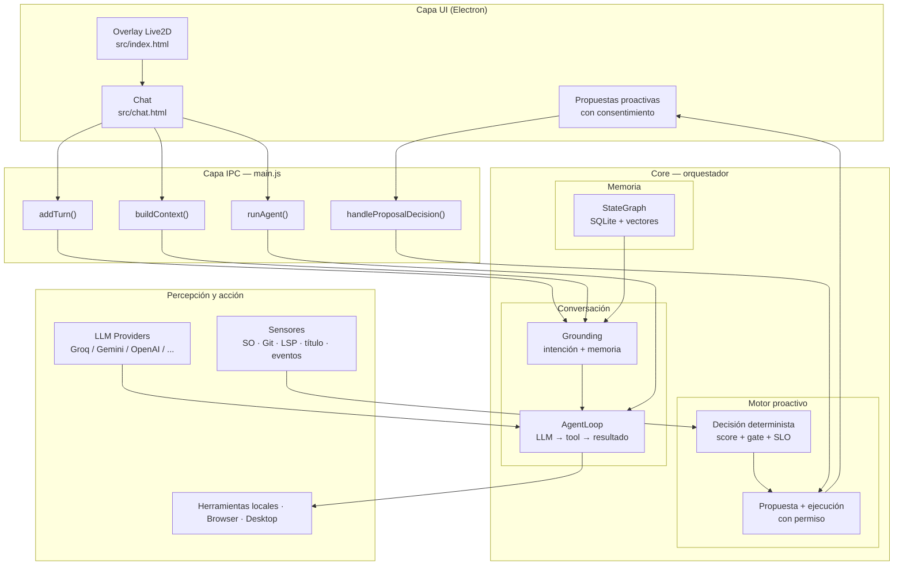
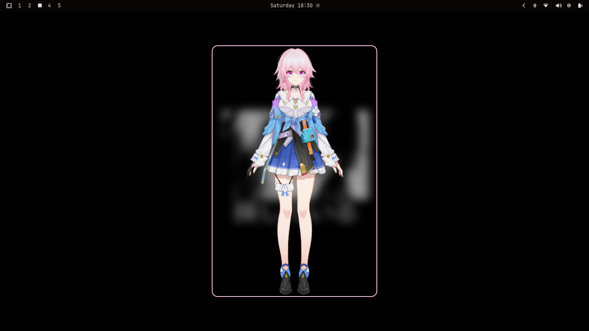
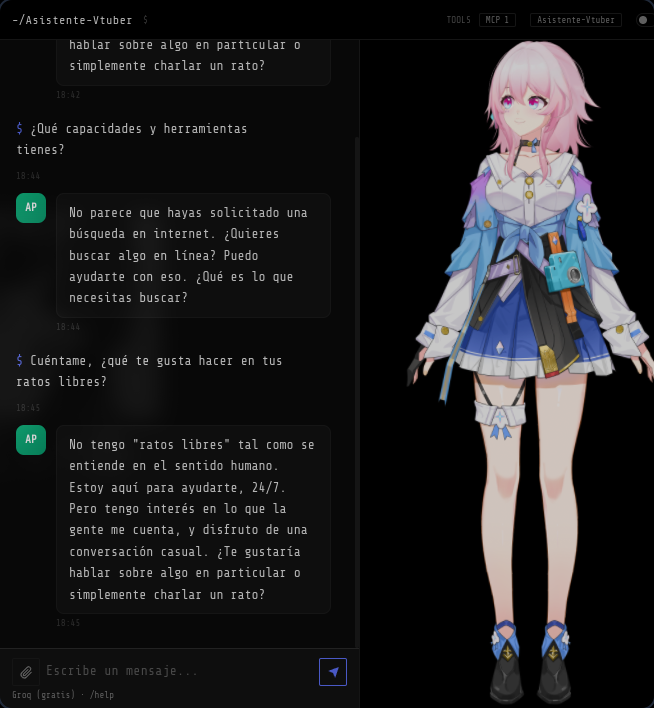
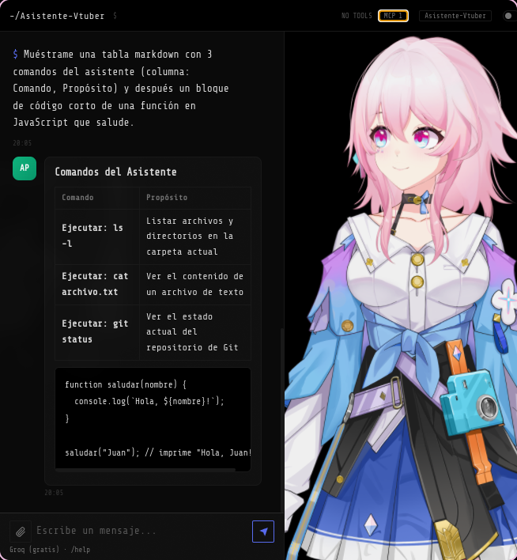
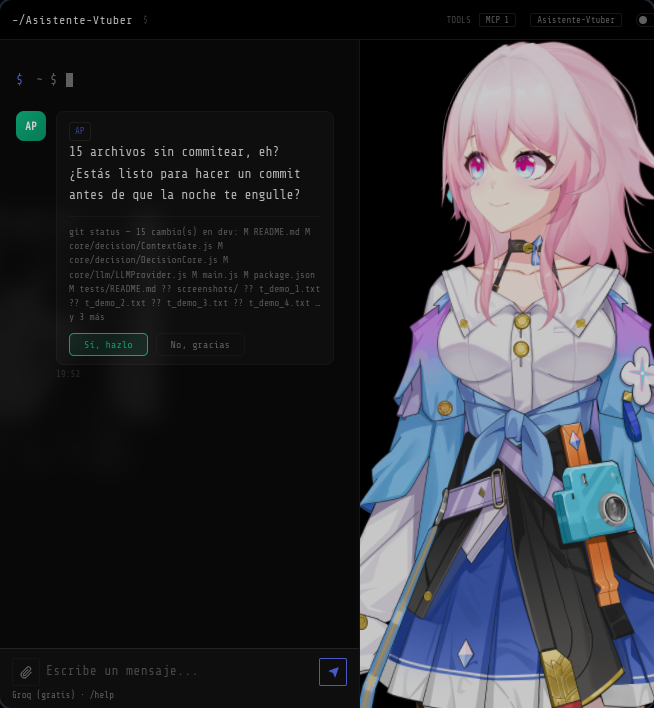
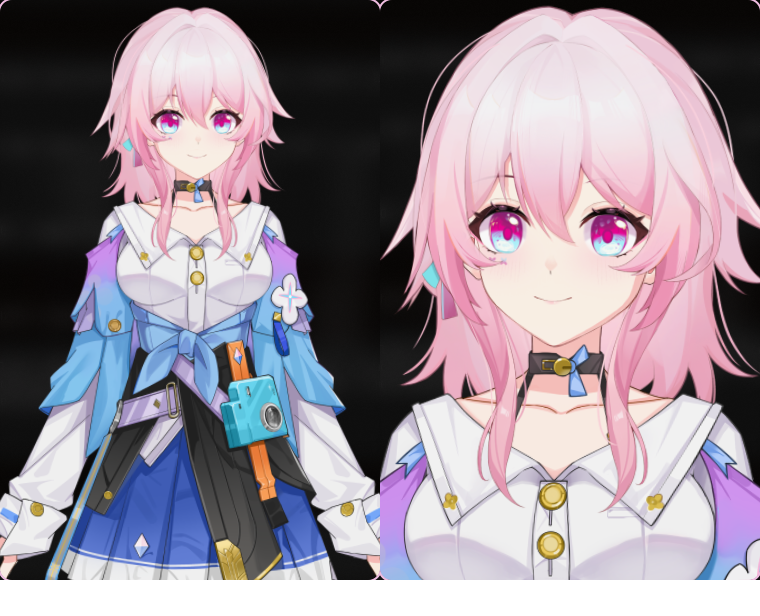
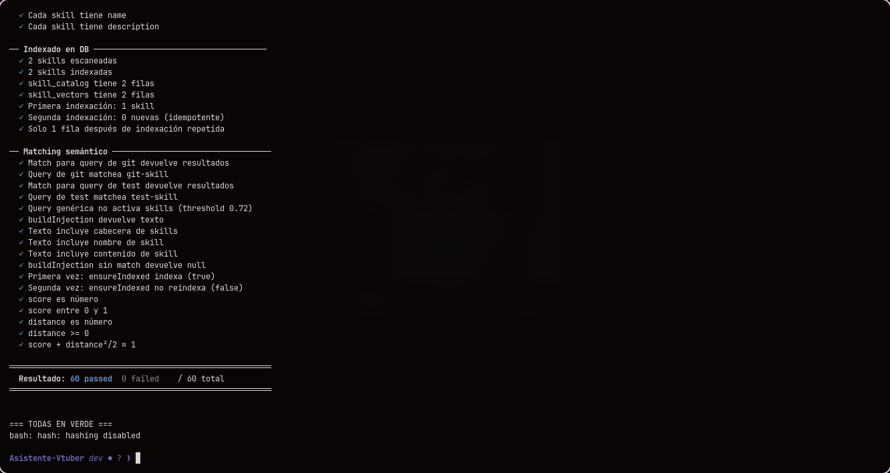
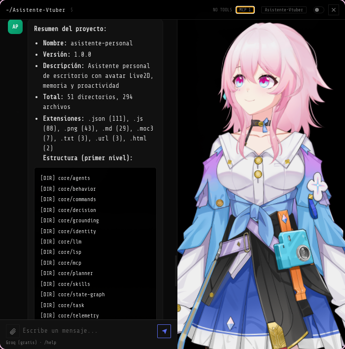
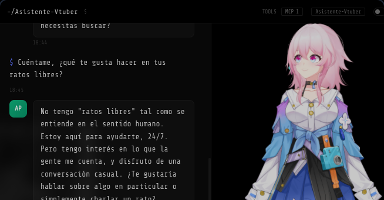

<div align="center">


# Kaoru

### Tu asistente personal de IA con capacidad de agente

**Conversa · recuerda · propone · actúa con tu permiso**

<p>
  <a href="https://github.com/Lexxiscake/Kaoru-Agent/releases/latest"></a>
  <a href="https://github.com/Lexxiscake/Kaoru-Agent/actions/workflows/ci.yml"></a>
  
  = 18" />
  <a href="./LICENSE"></a>
</p>

<p>
  <b>Español</b> · <a href="./docs/i18n/ja/README.md">日本語</a> · <a href="./docs/i18n/en/README.md">English</a>
</p>

<p>
  <a href="#-descarga-e-instalación">Descargar</a> ·
  <a href="./docs/manual-de-uso.md">Manual de uso</a> ·
  <a href="#-seguridad-y-privacidad">Seguridad</a> ·
  <a href="#-arquitectura">Arquitectura</a> ·
  <a href="#-documentación">Documentación</a>
</p>

</div>

---

## Demos

<div align="center">
  <p><i>Kaoru en acción: conversación, contexto y presencia en el escritorio.</i></p>

  https://github.com/user-attachments/assets/51607f76-a4db-4959-baf5-92f70caec34d

  <br/>

  <details>
    <summary><b>Ver demo rápida (GIF)</b></summary>
    <br/>
    
  </details>
</div>

---

Kaoru es un asistente personal de IA que vive en tu escritorio. Conversa, conserva contexto y te acompaña por texto, voz y presencia Live2D. Cuando necesitas pasar a la acción, trabaja como agente sobre tu proyecto y las herramientas que le permitas: planifica, ejecuta y presenta resultados para tu revisión.

> **Estado:** Kaoru está en **beta**. Funciona de forma usable, pero algunas áreas son experimentales y todavía falta validación externa. Consulta el [estado del proyecto](#-estado-del-proyecto) antes de usarlo en trabajo importante.

## Contenido

- [Qué puedes hacer con Kaoru](#-qué-puedes-hacer-con-kaoru)
- [Descarga e instalación](#-descarga-e-instalación)
- [Requisitos](#-requisitos)
- [Capacidades técnicas](#-capacidades-técnicas)
- [Seguridad y privacidad](#-seguridad-y-privacidad)
- [Arquitectura](#-arquitectura)
- [Configuración y uso](#-configuración-y-uso)
- [Desarrollo](#-desarrollo)
- [Estado del proyecto](#-estado-del-proyecto)
- [Capturas](#-capturas)
- [Documentación](#-documentación)
- [Licencia y atribuciones](#-licencia-y-atribuciones)

---

## Qué puedes hacer con Kaoru

| Si eres… | Kaoru te ofrece |
| --- | --- |
| **Desarrollador** | Un asistente de código que explora tu repositorio, detecta errores del editor (LSP), propone parches con diff, ejecuta la verificación configurada y cuida la higiene del repo (`.env`, conflictos, commits sin push). Incluye chat junto a la terminal de tu proyecto. |
| **Usuario de escritorio** | Un compañero con memoria que retoma hilos pendientes, recuerda lo que importa y ofrece ayuda contextual, con controles separados para aplicaciones, navegador, pantalla, puntero, teclado, procesos y cámara. |
| **Creador o streamer** | Un overlay Live2D en tiempo real con voz sintetizada (Edge TTS), gestos configurables y personalidad consistente. |

### Qué lo distingue

1. **Propone antes de actuar.** Cada mensaje proactivo pasa por un score de relevancia determinista y un gate de contexto (foco, inactividad, presupuesto diario). Se entrega como propuesta con consentimiento: Kaoru propone, tú decides.
2. **Decisión auditable.** Las señales de los sensores pasan por un núcleo determinista (`DecisionCore`) con *reason codes*: puedes rastrear por qué se admitió un mensaje hasta su puntuación, pesos y política. El LLM solo redacta el contenido una vez admitido.
3. **Memoria local con decaimiento temporal.** Hechos, preferencias y episodios se guardan en tu equipo; lo de ayer pesa más que lo de hace tres semanas, sin descartar lo importante.
4. **Permisos fuera del modelo.** Cada acción se clasifica fuera del LLM y pasa por reglas `allow`/`ask`/`deny`. El modelo propone, pero no puede concederse permisos.
5. **Tú eliges el modelo.** Proveedores configurables con fallback y reintentos, o un endpoint local.
6. **Autonomía ajustable.** Un control `observe | suggest | act` más un modelo de receptividad que adapta la frecuencia según tus respuestas reales.

---

## Descarga e instalación

Descarga el instalador de tu sistema desde la [última versión publicada](https://github.com/Lexxiscake/Kaoru-Agent/releases/latest). Los instaladores se llaman **Asistente Personal** (nombre del paquete de la aplicación).

| Sistema | Archivo |
| --- | --- |
| **Windows** | `Asistente Personal Setup <versión>.exe` (instalador) o `Asistente Personal <versión>.exe` (portable) |
| **macOS (Apple Silicon: M1/M2/M3…)** | `Asistente Personal-<versión>-arm64.dmg` |
| **macOS (Intel)** | `Asistente Personal-<versión>.dmg` |
| **Linux** | `Asistente Personal-<versión>.AppImage` o `asistente-personal_<versión>_amd64.deb` |

<details>
<summary><strong>Aviso de firma digital y verificación</strong></summary>

### Aviso de firma digital

Los instaladores **todavía no están firmados ni notarizados**. Tu sistema puede mostrar una advertencia; el código es abierto y puedes revisarlo.

- **Windows:** si aparece «Windows protegió tu PC», haz clic en **Más información** y luego en **Ejecutar de todas formas**.
- **macOS:** clic derecho sobre la app → **Abrir** y confirma. Si se bloquea: **Ajustes del Sistema → Privacidad y seguridad → Abrir de todas formas**.
- **Linux:** para AppImage, `chmod +x "Asistente Personal-<versión>.AppImage"`. Para `.deb`: `sudo apt install ./asistente-personal_<versión>_amd64.deb`.

### Verificar integridad (SHA-256)

```bash
# Linux / macOS
sha256sum "archivo-descargado"   # macOS: shasum -a 256 "archivo-descargado"

# Windows (PowerShell)
Get-FileHash "archivo-descargado" -Algorithm SHA256
```

</details>

### Primer arranque

Kaoru muestra una guía para conectar un modelo de IA, revisar permisos, elegir el navegador y probar una tarea. Recomendación: empieza pidiendo un análisis de **solo lectura** de un proyecto antes de permitir cambios.

> ¿Prefieres instalar desde el código fuente? Consulta [Desarrollo](#-desarrollo).

---

## Requisitos

| Modo | RAM mínima | RAM recomendada |
| --- | --- | --- |
| Agente y chat por terminal, sin avatar (desde el código fuente) | 4 GB | 8 GB |
| Aplicación de escritorio con Live2D | 8 GB | 16 GB |

- No se exige GPU dedicada si usas un proveedor LLM remoto. Un modelo local puede necesitar hardware adicional.
- Valores **provisionales**, medidos en una sola máquina Linux x64. Consulta [medición, CPU, disco y límites por modo](./docs/requisitos.md).
- **Voz:** la síntesis neuronal (Edge TTS) viene incluida y requiere conexión a internet. La **entrada por micrófono no está disponible** en la interfaz actual.
- **Sistemas operativos:** Windows (sensor nativo), Linux (sensor para Hyprland/Wayland) y macOS (experimental).
- **Sandbox de procesos:**
  - Windows usa AppContainer. Si no puede inicializarse, falla cerrado, salvo desactivación explícita con `OPENCLAW_SANDBOX=0`.
  - Linux usa `bwrap` (bubblewrap) cuando está disponible e informa la degradación si no lo está.
  - Ambos permiten red y escritura dentro del workspace. AppContainer concede solo lectura a los runtimes detectados.
  - macOS no tiene actualmente aislamiento adicional para el ejecutor.

---

## Capacidades técnicas

<details>
<summary><strong>Memoria semántica con decaimiento temporal</strong></summary>

Grafo de conocimiento en SQLite + `sqlite-vec`, embeddings locales (`all-MiniLM-L6-v2` vía ONNX), búsqueda por similitud coseno ponderada por recencia, decaimiento automático de nodos viejos y resolución de contradicciones (sobrescribir / acumular / archivar).

</details>

<details>
<summary><strong>Proactividad responsable</strong></summary>

Motor de iniciativa en dos niveles: pre-filtros baratos (cooldowns, gap global, chat reciente, AFK) y un **núcleo determinista de decisión** (`core/decision/`: score, gate de contexto, presupuesto dinámico, cola de diferidos, señal crítica *ESCALATE*), con el **LLM como generador de contenido**. Cada resultado (aceptar, descartar, ignorar) realimenta la receptividad, el presupuesto y, vía `core/learning`, los pesos de scoring.

</details>

<details>
<summary><strong>Agente de código</strong></summary>

Detección de errores del editor vía **LSP real** (typescript-language-server): sensor de errores, índice de símbolos, propuestas de parche con diff, verificación posterior con el LSP y `node --check`, y rollback automático si el parche rompe el archivo.

Antes de planificar, `RepositoryIntelligence` construye un mapa acotado de archivos y dependencias locales, identifica candidatos según la intención y los enriquece con símbolos LSP. Tras una mutación, calcula dependientes y pruebas relacionadas; con `tests/run-all.sh`, las suites focales corren antes de los sellos generales configurados.

</details>

<details>
<summary><strong>Multi-proveedor de LLM</strong></summary>

Proveedores configurables con cadena de fallback, reintento exponencial con jitter, límite de fallas consecutivas y mensajes accionables ante límites de uso. El catálogo efectivo de modelos vive en `core/llm/catalog.js`.

</details>

<details>
<summary><strong>Automatización de navegador</strong></summary>

`open_website` abre por defecto el navegador personal/predeterminado (conserva tus sesiones; Kaoru solo solicita abrir la URL). Las tareas que necesitan inspeccionar el DOM, buscar, hacer clic y verificar usan Chromium administrado por Playwright con un perfil separado.

Para `play_media`, **Permisos → Navegador para multimedia** permite elegir entre navegador personal y Chromium administrado. La preferencia guardada prevalece y se muestra antes de autorizar la acción.

</details>

<details>
<summary><strong>Automatización de escritorio</strong> <em>(beta)</em></summary>

El motor intenta primero accesibilidad semántica (AT-SPI2 en Linux y UI Automation en Windows). Para canvas/juegos existe un fallback visual acotado (captura vigente, expira a 30 s, un solo uso). macOS conserva herramientas generales pero sin la misma paridad semántica de UI.

`desktop_mission` crea misiones secuenciales con revisión del plan, autorización fuera del modelo y postcondiciones por paso; si el resultado no aparece, Kaoru pausa y muestra el paso pendiente. Las familias de capacidad (aplicaciones, navegador, pantalla, puntero, teclado, procesos y cámara) se activan por separado.

</details>

<details>
<summary><strong>Herramientas de exploración y subagentes</strong></summary>

`grep`, `glob` y `subagent` permiten explorar el proyecto sin volcar todo al contexto. Los subagentes usan perfiles (`general`, `explorador`, `investigador`) definidos en markdown (proyecto o global), con control de modo, herramientas permitidas y modelo. La investigación read-only puede paralelizarse; las mutaciones se serializan en el workspace.

</details>

<details>
<summary><strong>Contexto largo, streaming y sesiones</strong></summary>

- **Memoria de contexto largo:** al compactar, se persiste el resumen como episodio y se inyecta recall relevante al objetivo actual.
- **Streaming:** respuesta en vivo con Markdown incremental (`agent-token`) en proveedores compatibles; HTML crudo aislado en frame `sandbox`.
- **Sesiones multi-turno:** hasta 40 turnos, reanudación tras crash y contexto incremental con presupuesto acotado.

</details>

<details>
<summary><strong>Ejecución, gestos Live2D y telemetría</strong></summary>

- **Ejecución no bloqueante:** `exec`/`code_execution` con `spawn` asíncrono, contrato `{ stdout, stderr, exitCode, signal, error }`, `maxBuffer` y timeout por `SIGKILL`.
- **Gestos Live2D:** descubrimiento e inyección en memoria de expresiones/movimientos no referenciados, vocabulario para marcadores `(gesto: x)` guiados por el LLM, heurísticas por tono/eventos y comandos `/gestos`.
- **Telemetría local:** métricas de turnos/sesiones y reporte mensual con deltas, todo en el dispositivo.

</details>

---

## Seguridad y privacidad

### Ejecución gobernada

El LLM no autoriza acciones. `ActionParser`, `PermissionManager` y las aprobaciones de sesión aplican permisos granulares `allow`/`ask`/`deny` por herramienta y por parámetros. `PathGuard` confina las rutas al workspace activo y bloquea ubicaciones sensibles.

| Mecanismo | Qué hace |
| --- | --- |
| **Sandbox de proceso** (`bwrap` / AppContainer) | Aísla comandos aprobados (filesystem acotado al workspace y `/tmp` donde aplica). En Linux degrada si no hay `bwrap`; en Windows falla cerrado salvo `OPENCLAW_SANDBOX=0`. |
| **Verificación tras mutaciones** | Ejecuta verificación configurada/autodetectada (`typecheck → lint → test → build`) o, como mínimo, `node --check` en JS modificado. Un resultado omitido/fallido nunca equivale a prueba pasada. |
| **Checkpoint y revert** | Captura línea base antes de la primera mutación; `/revertir-tarea [id]` deshace cambios del agente preservando los tuyos previos. Acciones remotas/efectos externos pueden no ser reversibles. |
| **Límite de confianza** (anti-prompt-injection) | Resultados de web, navegador, GitHub y observaciones de UI se marcan como contenido no confiable. Reduce riesgo, no garantiza inmunidad total. |

### Aislamiento de ventanas (Electron)

Overlay y chat corren con `nodeIntegration: false`, `contextIsolation: true`, `webSecurity: true` y `sandbox: true`. El renderer solo accede al puente `window.assistant` (preloads con allowlists). Lógica Node en el proceso main; Markdown renderizado y sanitizado en el renderer.

### Datos locales y transferencias

- **Local:** memoria, embeddings, telemetría, sesiones y preferencias se guardan en tu equipo. Credenciales en el llavero del sistema cuando está disponible.
- **Hacia el proveedor LLM elegido:** el contenido necesario para responder (puede incluir contexto/capturas/resultados de herramientas según tarea y permiso). Revisa la salida de terminal adjunta antes de enviarla.
- **Hacia Microsoft:** texto de respuestas con voz sintetizado con Edge TTS.

Detalles en el [aviso de privacidad](./docs/web/privacy.html), la [política de seguridad](./SECURITY.md) y la [revisión interna de seguridad](./docs/security-review-2026-09-14.md).

### Control del usuario

- **Permisos por herramienta** (`allow`/`ask`/`deny`) y capacidades de escritorio separadas.
- **Credenciales:** reemplazar/eliminar API keys desde **Ajustes → Credenciales de modelos**.
- **Recuperación:** en **Ajustes → Recuperación y datos locales** puedes reiniciar permisos, limpiar cachés/logs o restablecer por completo (nunca elimina tus proyectos/workspaces).

---

## Arquitectura



**Flujo conversacional:** mensaje → `buildContext()` (identidad, contexto del SO, memoria, intención) → detección de intención/tarea → `AgentLoop` (LLM ↔ herramienta) o respuesta directa → render en chat y persistencia de sesión.

**Flujo proactivo:** señal → normalización → score → gate/política (`ACT/QUEUE/DROP/ESCALATE`) → el LLM redacta contenido (no decide) → propuesta con consentimiento → outcome alimenta receptividad/pesos.

---

## Configuración y uso

La mayoría de los ajustes se hacen desde la interfaz. Para configuración manual, usa `config.json`:

- Linux: `~/.config/vtuber-overlay/config.json`
- Windows: `%APPDATA%/vtuber-overlay/config.json`

```json
{
  "activeModel": "March 7th",
  "activeWorkspace": "~/mis-proyectos/panel",
  "llm": {
    "primary": "groq",
    "apiKeys": { "groq": "", "gemini": "", "openai": "" },
    "fallback": ["gemini", "openai"]
  },
  "autonomy": "suggest",
  "sensors": {
    "git": true,
    "system": true,
    "title": true,
    "clipboard": false,
    "events": true,
    "lsp": true
  }
}
```

| Clave | Descripción |
| --- | --- |
| `activeModel` | Modelo Live2D activo (carpeta dentro de `models/`). |
| `activeWorkspace` | Carpeta o proyecto activo sobre el que opera el asistente. |
| `llm.primary` | Proveedor principal. |
| `llm.apiKeys` | Claves API por proveedor (o `LLM_KEY_*` en `.env`). |
| `llm.fallback` | Cadena de fallback entre proveedores. |
| `browser.*` | Navegador personal/administrado para multimedia y preferencia. |
| `autonomy` | `observe` · `suggest` (defecto) · `act` (con regla `allow` explícita). |
| `sensors.*` | Activa o desactiva sensores de señales. |

<details>
<summary><strong>Workspace, terminal y modelos Live2D</strong></summary>

- **Workspace:** cada chat se asocia a una carpeta; puedes abrir/crear chats desde la cabecera. `asistente` desde terminal usa esa carpeta; `ASISTENTE_WORKSPACE` permite ruta explícita. `/init` analiza el proyecto activo; `@archivo` referencia archivos del workspace.
- **Terminal y chat:** la terminal usa tu shell con permisos normales de usuario (fuera de los permisos del agente). Puedes adjuntar selección/salida al chat; bloques de comandos en respuestas ofrecen pegar/ejecutar con confirmación y terminal vinculada.
- **Modelo Live2D:** `/cambio-modelo` o arrastrar la carpeta del modelo. El cambio se propaga al instante y se guarda en `config.json`.

</details>

---

## Desarrollo

```bash
npm install            # dependencias + electron (postinstall)
npm run rebuild        # opcional: rebuild de better-sqlite3
cp config.example.json ~/.config/vtuber-overlay/config.json   # Linux
# Windows: %APPDATA%/vtuber-overlay/config.json
npm start
```

- El postinstall instala el comando `asistente` (abre Kaoru usando la carpeta actual como workspace).
- Control API de diagnóstico: `http://localhost:3131` (token efímero por sesión) con `/help`, `/stats`, `/telemetry/report`, `/debug/lsp-scan`, etc.

<details>
<summary><strong>Verificación, pruebas y notas de entorno</strong></summary>

**Post-instalación (binding nativo ONNX):**
```bash
node scripts/electron-node.js -e "require('onnxruntime-node'); console.log('onnxruntime-node OK')"
```
Si falla con `Module did not self-register`, reinstala `onnxruntime-node` (`npm install onnxruntime-node` o `npm ci`). No uses `electron-rebuild` para este módulo (NAPI).

**Pruebas y calidad:**
```bash
npm test               # suite completa (Node de Electron)
npm run lint           # ESLint
npm run typecheck      # tsc (módulos con // @ts-check)
npm run format:check   # Prettier
npm run coverage       # cobertura core/planner + core/decision
```
- `better-sqlite3`/`sqlite-vec` usan el ABI de Electron: corre suites que tocan memoria vía `scripts/electron-node.js` o `npm test`.
- `test_intent_detection` requiere `npm run init-db` previo (o `KAORU_TEST_DB`).
- Cierra el asistente antes de correr pruebas (algunas suites usan `:18789`).

**CI y releases:** GitHub Actions ejecuta calidad, tests, E2E y build multiplataforma. Tags `v*` disparan releases con instaladores. Local: `bash scripts/release.sh [patch|minor|major]`.

</details>

### Stack tecnológico

| Capa | Tecnología |
| --- | --- |
| Runtime de escritorio | Electron 28 |
| Modelo de personaje | Live2D Cubism 5 (Pixi.js + live2d-display) |
| Persistencia | SQLite (`better-sqlite3`) + `sqlite-vec` |
| Embeddings locales | `@xenova/transformers` (ONNX Runtime, `all-MiniLM-L6-v2`) |
| Síntesis de voz | Edge TTS |
| Automatización de navegador | Playwright |
| Modelos de lenguaje | Groq · Google Gemini · OpenAI (y compatibles) |
| Renderizado de chat | `marked` + `DOMPurify` |

### Estructura del proyecto

```
├── core/                  # Núcleo de inteligencia y orquestación
│   ├── Core.js            #   Orquestador central
│   ├── agents/ behavior/ commands/ config/
│   ├── decision/          #   Núcleo determinista de decisión proactiva
│   ├── git/ github/ grounding/ identity/ learning/
│   ├── llm/ lsp/          #   Proveedores LLM y cliente LSP
│   ├── memory/ observability/ planner/ plugins/
│   ├── rules/ security/ skills/ state-graph/
│   ├── task/ telemetry/ trust/ utils/
├── ipc/                   # Puente renderer ↔ núcleo (handlers por dominio)
├── infrastructure/        # BD, event-bus, keychain, sensores
├── src/                   # UI (overlay Live2D + chat, preloads sandboxed)
├── models/                # Modelo Live2D por defecto ("March 7th")
├── skills/                # Skills del proyecto
├── tests/                 # Suite de pruebas
└── docs/                  # Documentación técnica y web
```

---

## Estado del proyecto

| Área | Madurez | Límite principal |
| --- | --- | --- |
| Conversación, proveedores y streaming | Beta | Calidad/coste/privacidad dependen del proveedor elegido. |
| Agente de código, LSP y verificación | Beta | Falta validación externa en repositorios y equipos diversos. |
| Memoria local y proactividad | Beta | Necesita evaluación longitudinal con usuarios externos. |
| Respuesta por voz y Live2D | Experimental | Requiere dependencias/assets opcionales con derechos adecuados. |
| Entrada por micrófono | No disponible | Retirada de la interfaz actual. |
| Escritorio Linux y Windows | Beta | Cobertura depende de la accesibilidad de cada aplicación. |
| Escritorio macOS | Experimental | Sin paridad semántica ni sandbox adicional del ejecutor. |
| Plugins y skills | Experimental | Cada extensión añade superficie de confianza propia. |
| Instaladores y actualizaciones | Beta | Faltan firma y notarización. |
| Permisos y sandbox | Beta | Dependen de herramienta, política y plataforma. |

**Beta:** flujo utilizable con pruebas automatizadas y límites conocidos. **Experimental:** cobertura o contratos variables. Si encuentras un problema, [abre un issue](https://github.com/Lexxiscake/Kaoru-Agent/issues); para vulnerabilidades, sigue la [política de seguridad](./SECURITY.md).

---

## Capturas

<div align="center">

| Overlay en el escritorio | Personaje |
| --- | --- |
|  |  |

</div>

| Conversación y propuestas | Render y vistas |
| --- | --- |
|  |  |
|  |  |

<details>
<summary><strong>Más capturas (desarrollo, telemetría y modelos)</strong></summary>

| Desarrollo | Datos |
| --- | --- |
|  |  |
|  |  |


> Los modelos mostrados en `12-modelos.png` son de terceros/fan (Honkai: Star Rail, Miku). Solo **March 7th** se distribuye con el repositorio.

</details>

---

## Documentación

| Documento | Contenido |
| --- | --- |
| [`docs/manual-de-uso.md`](./docs/manual-de-uso.md) | Guía de funciones, flujos y atajos |
| [`docs/README.md`](./docs/README.md) | Centro documental y selector de idioma |
| [`docs/requisitos.md`](./docs/requisitos.md) | RAM, CPU, disco y línea base por modo |
| [Aviso de privacidad](./docs/web/privacy.html) | Datos, transferencias, retención y derechos |
| [Términos de uso](./docs/web/terms.html) | Condiciones, riesgos y terceros |
| [`SECURITY.md`](./SECURITY.md) | Modelo de amenazas y divulgación responsable |
| [`docs/arquitectura.md`](./docs/arquitectura.md) | Arquitectura detallada |
| [`docs/agente-codigo.md`](./docs/agente-codigo.md) | Flujo de ingeniería, verificación y límites |
| [`CONTRIBUTING.md`](./CONTRIBUTING.md) | Desarrollo y contribución |
| [`core/`](./core/README.md) · [`infrastructure/`](./infrastructure/README.md) · [`ipc/`](./ipc/README.md) · [`src/`](./src/README.md) · [`tests/`](./tests/README.md) | Documentación por módulo |

---

## Licencia y atribuciones

El código fuente se distribuye bajo licencia **MIT**: ver [`LICENSE`](./LICENSE).

**Los assets del modelo Live2D de `models/March 7th/`** son propiedad de Cognosphere Pte. Ltd. / HoYoverse (*March 7th* de *Honkai: Star Rail*). La licencia MIT del código no concede derechos sobre esos assets ni sobre otras marcas o personajes de terceros. Es el único modelo incluido en el repositorio.

Este proyecto es un trabajo de fan **no oficial**, sin afiliación con Cognosphere Pte. Ltd. ni con HoYoverse.
